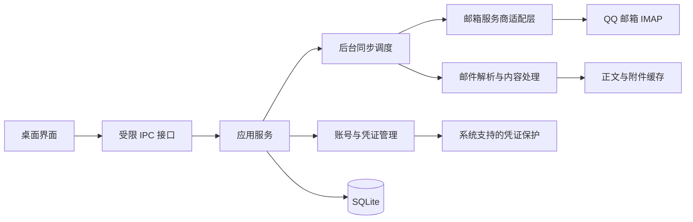

# MailDeck 产品与技术规划

规划日期：2026-10-24  
状态：总体方案规划；技术栈与首版范围已确认，以 TECH_STACK.md、ROADMAP.md 为准  
当前交付范围：Markdown 规划文档

## 1. 产品定位与已确认需求

MailDeck 是面向个人的桌面邮箱接收管理工具，将多个邮箱账号的邮件集中展示，减少来回切换账号的操作。

| 项目 | 已确认内容 |
| --- | --- |
| 使用对象 | 个人用户，管理自己的多个邮箱账号 |
| 产品形态 | 桌面应用 |
| 数据位置 | 账号配置和邮件缓存保存在本机 |
| 首版服务商 | QQ 邮箱，可添加多个 QQ 邮箱账号 |
| 后续方向 | 逐步增加其他邮箱服务商 |
| 当前工作 | 仅进行文档规划 |

除本节外，后续内容均为可调整的方案建议。尤其是发行平台、技术栈、同步策略和首版功能，需要在开发前完成确认。

## 2. 首版目标

用户可以添加至少两个 QQ 邮箱账号，在同一个收件箱中看到新邮件、识别邮件所属账号并阅读内容。网络中断或某个账号失效时，应用可以继续展示已缓存邮件，其余账号保持独立运行。

建议先完成以下闭环：

1. 添加 QQ 邮箱账号并验证连接。
2. 同步收件箱，展示各账号邮件。
3. 在统一列表中筛选、搜索和阅读邮件。
4. 将已读、未读操作同步回对应 QQ 邮箱。
5. 清楚展示同步进度、离线状态和需要重新授权的账号。

首版的规模验收建议使用 5 个账号；这只是初期测试基线，不作为产品账号数量上限。

自动同步以应用运行且网络可用为前提；退出应用后不更新本地缓存，下次启动或休眠恢复后补齐变化。关闭窗口是否保留后台运行，需结合首发系统另行确认。

## 3. 版本范围建议

### 3.1 v0.1：接收、阅读与基础管理

| 能力 | 建议范围 | 完成标准 |
| --- | --- | --- |
| 账号管理 | 添加多个 QQ 邮箱账号，设置显示名称与颜色，暂停同步、移除账号 | 每个账号可独立连接、暂停和恢复 |
| 统一收件箱 | 所有账号合并显示，同时支持按账号切换 | 每封邮件明确标注所属账号，时间排序稳定 |
| 邮件列表 | 展示发件人、主题、收件时间、未读状态、附件标识 | 支持分页，加载旧邮件时保留当前位置 |
| 邮件阅读 | 纯文本和经过安全处理的 HTML 正文 | 正确处理常见编码、内嵌图片及多部分邮件 |
| 已读管理 | 标记已读、未读；与服务端同步 | 读取正文不会误触其他邮件的已读状态，失败时有明确反馈 |
| 基础检索 | 对已同步的发件人、主题进行搜索，按账号、未读筛选 | 界面说明检索范围，中文主题可以检索 |
| 附件 | 显示名称、类型、大小，用户主动选择后保存 | 正文加载不自动下载普通附件，下载失败可重试 |
| 同步状态 | 自动接收、手动刷新、展示最后同步时间与失败原因 | 一个账号失败不阻塞其他账号 |
| 本地缓存 | 保存已同步列表和已打开的正文 | 离线可查看这些内容，尚未缓存的正文有清楚提示 |

说明：账号移除只清理本应用中的账号配置、凭证和本地缓存，不向 QQ 邮箱发送删信操作。产品界面需要在移除前说明影响并确认。

### 3.2 后续版本候选

| 阶段 | 候选能力 | 进入条件 |
| --- | --- | --- |
| v0.2 | 桌面新邮件通知、批量已读、本地收藏、正文检索 | 首版同步和阅读链路稳定后，结合实际使用反馈排序 |
| v0.3 | 查看更多邮件文件夹、移动邮件、规则分类 | 先确定与服务端文件夹及状态的一致性规则 |
| 后续 | 新增邮箱服务商 | 按用户实际需要逐个接入并验证认证方式 |

首版暂不规划发信、回复、转发、SMTP、多人协作、云端账号系统、跨设备同步、AI 邮件处理和自动删信。

## 4. QQ 邮箱接入方案

### 4.1 用户添加账号的流程

1. 在 QQ 邮箱官方设置中开启 IMAP，并按官方流程生成授权码。
2. 在 MailDeck 输入邮箱地址、授权码和可选的显示名称。
3. 应用连接 QQ 邮箱，验证认证、收件箱访问和基础能力。
4. 验证成功后保存凭证，开始首次同步。
5. 页面显示同步阶段、已加载数量及当前覆盖范围。

QQ 邮箱官方帮助说明，授权码用于第三方客户端登录；更改账号密码会使授权码过期。应用应提供“更新授权码”的入口，保留原账号的配置和缓存。[Q1]

### 4.2 连接基线

| 项目 | 方案 |
| --- | --- |
| 接收协议 | IMAP，通过 TLS 连接 |
| 服务器 | `imap.qq.com` |
| 端口 | `993` |
| 用户名 | 完整邮箱地址 |
| 凭证 | QQ 邮箱授权码 |
| 首版同步目录 | 收件箱，实际目录路径通过服务端查询确定 |
| 新邮件发现 | 能力探测后优先使用 IDLE，保留定时检查与手动刷新 |

腾讯云官方资料中的 QQ 邮箱配置示例给出了上述 IMAP 地址和端口。[Q2] 该示例属于较早发布的资料；实际客户端兼容性、TLS 连接、IDLE 稳定性、频率与连接数量限制仍需在开发可行性验证阶段使用真实测试账号确认，不承诺所有 IMAP 扩展均可使用。

### 4.3 需要提前验证的行为

- 主地址、别名与重复添加账号的识别方式，避免对同一邮箱反复建立连接。
- 新邮件到达、其他客户端修改已读状态、邮件移出收件箱后的可见行为。
- 中文主题、不同字符编码、普通附件、内嵌图片、大正文及格式异常邮件的兼容性。
- 授权码过期、网络切换、系统休眠后恢复、服务端主动断开时的恢复路径。

这些是后续开发的验证事项，本轮文档工作不连接真实邮箱。

## 5. 页面与交互结构

建议主窗口采用三栏布局：

| 区域 | 主要内容 |
| --- | --- |
| 左侧账号栏 | 统一收件箱、各个 QQ 账号、已同步范围内的未读数量、账号状态、添加账号入口 |
| 中间邮件列表 | 搜索框、账号与未读筛选、邮件摘要列表、刷新与加载更早邮件入口 |
| 右侧阅读区 | 所属账号、发件人与收件人、主题、时间、正文、附件、已读操作 |

辅助页面包括：添加或编辑账号、缓存与隐私设置、账号连接错误详情。

关键交互约定建议如下：

- 账号颜色和名称在合并列表与阅读区保持一致，减少多账号混淆。
- 首次同步先展示已获取的邮件，不等待所有账号完成。
- 搜索、列表和未读统计默认基于已同步范围，界面持续显示该范围；将来若展示服务端总未读数，应使用不同标签。
- 打开邮件并成功展示正文后，才按设置触发已读操作；后台预取不改变已读状态。
- 外部图片默认不联网加载，用户可以为当前邮件主动开启；随邮件携带的内嵌图片由本地内容映射展示。
- 所有外部链接由用户点击后交给系统浏览器，邮件正文不能自行导航应用窗口。
- 同步失败提示应能区分授权失效、网络不可用、服务器暂时拒绝、单封邮件解析失败。

## 6. 技术方案建议

### 6.1 已确认选型

技术栈已于 2026-10-24 确认为 Rust + Tauri，完整对比记录、依赖明细与验证点见[技术选型](../02-architecture/TECH_STACK.md)。

| 层级 | 选择 |
| --- | --- |
| 桌面框架 | Tauri v2，Rust 后端 + 系统 WebView [T1] |
| 界面 | React + TypeScript（Vite 构建） |
| 异步运行时 | tokio |
| IMAP 客户端 | async-imap + tokio-rustls |
| 认证 | QQ 授权码（IMAP 登录） |
| 邮件解析 | mail-parser [T2] |
| HTML 安全处理 | ammonia [T3] |
| 本地存储 | SQLite（rusqlite） |
| 凭证保护 | keyring（系统凭证库） |

放弃的候选：Electron（包体积与资源占用偏高）、Go + Wails（邮件解析与桌面插件生态弱于 Tauri），对比依据见 TECH_STACK.md 第 2 节。

### 6.2 模块边界

- 界面负责展示和用户操作，不直接持有邮箱凭证或 IMAP 连接。
- 应用服务负责账号、查询、已读操作和缓存管理，通过有限的 IPC 方法提供能力。
- 同步与解析放在后台执行单元，避免网络等待或大邮件解析阻塞界面和主进程；进程形式在选型验证时决定。
- 服务商适配层封装认证、目录、增量同步、正文获取和已读标记，首版只实现 QQ。
- 后续服务商可通过 IMAP 或独立 API 实现适配，界面不依赖具体协议。

首版只保留必要的适配接口，不搭建插件市场、通用规则引擎或多租户系统。

## 7. 同步与本地数据设计

### 7.1 首次与增量同步

1. 每个账号独立维护连接、状态、重试次数和同步进度，先采用每账号一条收件箱连接的方案进行验证。
2. 首次建议同步最近 500 封邮件的元数据，以分批加载方式尽快展示结果；用户可继续加载更早的邮件。
3. 先获取邮件结构，再按 MIME 部分获取正文和必要的内嵌资源并缓存，普通附件由用户主动下载；避免为阅读正文直接下载包含全部附件的原始邮件。内嵌资源设大小限制，超限时提示手动加载。
4. 增量同步使用邮箱标识、`UIDVALIDITY` 和 UID 定位消息，不能仅依赖邮件到达时间或序号。[P1]
5. 服务端支持时使用额外的增量同步能力；不支持时仍需可靠发现新增、状态变化和离开收件箱的邮件。
6. IDLE 负责及时发现变化，重连和定期核对负责补齐遗漏；轮询间隔、退避参数在真实 QQ 账号验证后确定。
7. 邮件记录与同步游标在同一事务中提交，避免失败后跳过邮件。
8. `UIDVALIDITY` 变化时重建对应收件箱的 UID 索引，不能继续复用旧游标。[P1]

历史加载范围、已同步范围和最近同步时间都需要在界面中可见。首版不承诺全量历史邮件已经保存在本机。

### 7.2 已读状态与失败恢复

- 远端状态是已确认状态来源；本地保存最近已知值和待提交的用户操作。
- 在线操作先显示“同步中”，服务端确认后标记完成；失败则明确保留待处理状态或回退。
- 离线浏览已缓存正文不阻塞用户；产生的已读、未读操作可排队，重连后按账号串行提交。
- 待提交操作按邮件和标记合并为最终意图，重试前重新定位邮件；邮件已不存在时停止该操作并说明原因。
- 离线后重放显式的已读、未读操作，可能覆盖其他客户端期间修改的同一标记；界面需显示待同步状态。是否允许离线修改作为开发前的取舍项。
- 单封邮件解析失败应隔离并记录摘要错误，账号认证失败则暂停该账号自动重试并引导更新授权码。

### 7.3 核心数据实体

| 实体 | 主要信息 |
| --- | --- |
| 账号 | 服务商、邮箱地址、显示名称、颜色、凭证引用、同步开关、连接状态 |
| 邮件目录 | 账号、服务端路径、`UIDVALIDITY`、同步游标、历史覆盖范围 |
| 邮件索引 | 账号、目录、UID、Message-ID、发件人、收件人、主题、时间、已读状态 |
| 正文缓存 | 邮件引用、纯文本、处理后的 HTML、内嵌资源映射、缓存时间 |
| 附件元数据 | 邮件引用、MIME 部分标识、原始名称、类型、大小、本地文件位置 |
| 待同步操作 | 账号、目标邮件、期望已读状态、创建顺序、重试及失败信息 |
| 应用设置 | 主题、图片加载策略、缓存策略、后续通知偏好 |

远端邮件的唯一约束建议由账号、目录、`UIDVALIDITY`、UID 组成。`Message-ID` 作为辅助字段，不单独作为唯一键。[P1]

首版搜索优先确保发件人、主题的中文匹配和可解释的范围提示。是否使用全文索引由数据量和中文检索验证决定，正文全文检索留待后续版本。

## 8. 本地数据与邮件内容的保护

- 授权码仅保存在经系统支持机制保护的凭证存储中，日志、错误上报和普通配置不记录授权码。
- 凭证保护统一走系统凭证库（`keyring`：macOS Keychain、Windows 凭据管理器、Linux libsecret）；Linux 环境还需处理凭证库不可用时的降级提示，不能默默按不符合预期的方式保存。
- 邮件正文及附件缓存包含个人内容，应用需要提供数据位置说明和清理入口；凭证加密不能被表述为整个邮件缓存已加密。
- HTML 邮件需要专门的内容清理和隔离，采用 ammonia 白名单式清理，默认剥除脚本、表单与主动导航。[T3]
- 阅读区禁用脚本、表单和主动导航，不向前端暴露凭证或任意文件访问能力；具体策略需与 Tauri 的 capability 权限模型一起验证。[T1]
- 远程图片默认关闭；附件不自动执行或打开，保存时处理路径穿越、非法名称及重名问题。
- 限制单封邮件解析、内嵌资源和下载的资源消耗；异常内容不能阻塞其他邮件。
- 日志默认仅保留运行状态和经过处理的错误信息，不记录完整邮件正文。诊断导出需先展示范围。

## 9. 建议实施里程碑

以下是后续开发计划，不表示当前开始开发。先按交付物和验收门槛分段，需求确认后再估算工期。

| 阶段 | 交付物 | 验收门槛 |
| --- | --- | --- |
| M0 需求与选型确认 | 首版清单、目标系统、凭证与缓存策略、页面结构 | 本文待确认项得到取舍，首版范围固定 |
| M1 接入可行性验证 | QQ 连接、增量获取、正文解析、已读同步的验证记录 | QQ 两个真实测试账号可独立完成核心链路，明确不支持能力 |
| M2 桌面基础与账号 | 应用窗口、账号管理、凭证存储、本地数据结构 | 重启后配置恢复，账号失败可定位，日志不含凭证 |
| M3 统一收件与阅读 | 合并列表、筛选检索、正文和附件、按需缓存 | 多账号阅读闭环完整，中文和常见 MIME 内容可用 |
| M4 稳定性与分发 | 重连、恢复、缓存清理、安装包与升级策略 | 达到首版验收标准，完成目标平台的打包与签名评估 |

M1 是正式实现的重要决策门槛。如果 QQ 的实际行为与预期不一致，应先调整同步承诺和体验，再扩展页面功能。

## 10. 首版验收清单草案

- 可以添加至少两个独立 QQ 邮箱账号，并完成多账号合并查看。
- 建议在 5 个账号的测试规模下，持续接收期间界面保持可操作，失败账号不拖累其他账号。
- 首次加载范围清楚，加载旧邮件不会造成列表重复或漏过已确认同步的邮件。
- 已读、未读操作能够在 QQ 邮箱中验证，失败或待同步状态对用户可见。
- 从其他客户端移走邮件后，本地收件箱经同步可以正确反映变化。
- 常见中文邮件、HTML、纯文本、附件及内嵌图片可以阅读；异常邮件不会卡住整个账号。
- 重启、网络中断、休眠唤醒和授权码失效后有明确且可恢复的状态。
- HTML 正文不能执行脚本、访问特权接口或自动打开外部页面；远程图片遵循设置。
- 账号授权码不出现在源码、普通配置和日志中。
- 移除账号和清理缓存只影响本地数据，QQ 邮箱中的原始邮件保持不变。

具体同步延迟、内存占用、启动时间和安装包大小的数值目标，在 M1 获得测量基线后补充。

## 11. 开发前待确认事项

| 事项 | 当前建议 | 对范围的影响 |
| --- | --- | --- |
| 首发操作系统 | 已确认 macOS（优先 Apple Silicon），Windows / Linux 按需后置，见 [技术选型](../02-architecture/TECH_STACK.md) 第 5 节 | 凭证走 macOS Keychain；签名与打包验证按 macOS 执行 |
| 预计账号数量 | 以 2–5 个账号起步验证，保留后续扩大空间 | 影响连接调度和性能验收 |
| 首次历史范围 | 最近 500 封元数据，按需继续加载 | 影响首次体验、磁盘和同步时长 |
| 已读行为 | 正文成功展示后自动标记已读，提供设置 | 影响远端写入时机 |
| 离线已读操作 | 建议排队并显示待同步状态；也可首版限制为在线操作 | 影响状态冲突与恢复复杂度 |
| 新邮件通知 | 建议 v0.2 再加入 | 如果作为首版核心需求，需要调整里程碑 |
| 本地缓存保护 | 凭证必须受保护；是否要求邮件库整体加密需单独确认 | 影响数据库方案和恢复策略 |
| 技术栈 | 已确认 Rust + Tauri + React/TypeScript + SQLite，见 [技术选型](../02-architecture/TECH_STACK.md) | 已确认，开发遵循该文档 |

## 12. 核实资料

以下资料用于确认接入与候选方案的可行性。核实日期为 2026-10-24，正式开发前仍需复查服务商设置及所选依赖版本。

- [Q1] QQ 邮箱帮助：《如何生成授权码，在第三方客户端使用 POP/IMAP/SMTP 等协议登录》。  
  `https://help.mail.qq.com/detail/106/985`
- [Q2] 腾讯云《企业集成服务·快速入门》PDF 第 33 页，QQ 邮箱配置示例；版权年份为 2021，连接参数作为开发前待复核的方案基线。  
  `https://main.qcloudimg.com/raw/document/product/pdf/1270_46586_cn.pdf`
- [P1] RFC 9051：IMAP4rev2，关于消息 UID、`UIDVALIDITY`、序号及 IDLE 的协议约定。具体支持范围以 QQ 服务端能力为准。  
  `https://www.rfc-editor.org/rfc/rfc9051.html`
- [T1] Tauri 官方文档《Security》与 capability 权限模型。  
  `https://tauri.app/security/`
- [T2] docs.rs《mail-parser》。  
  `https://docs.rs/mail-parser`
- [T3] docs.rs《ammonia》。  
  `https://docs.rs/ammonia`
